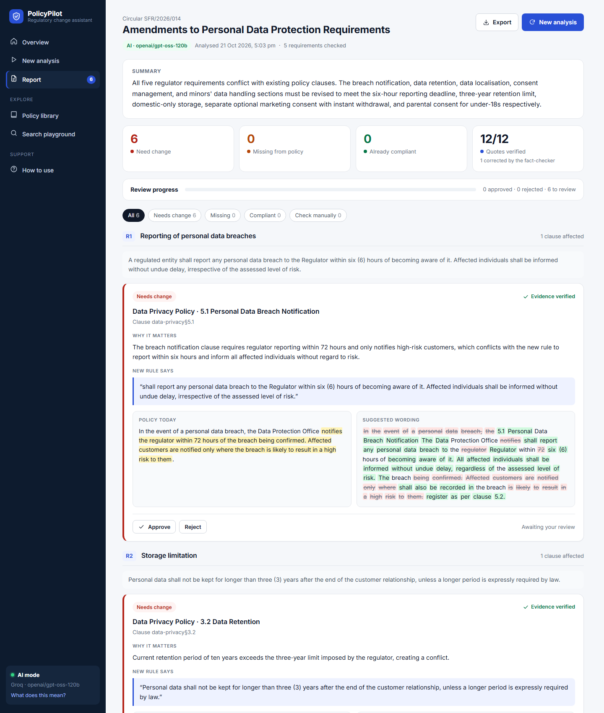
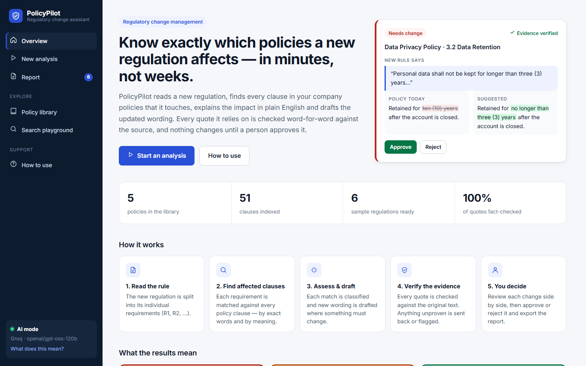
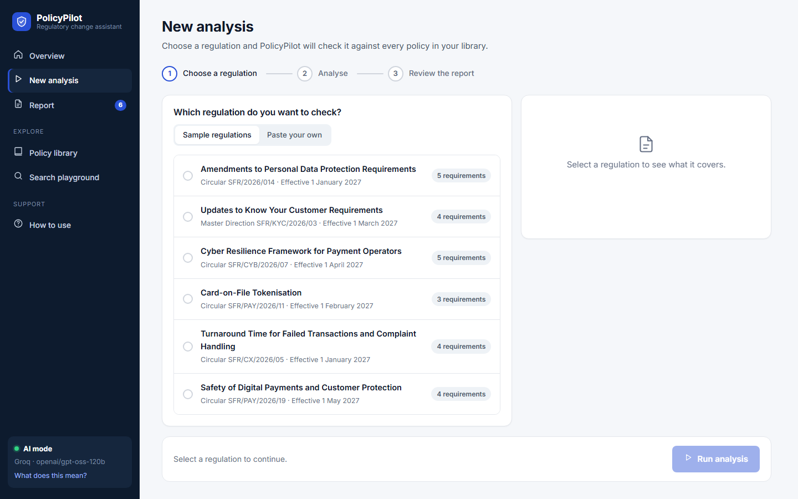
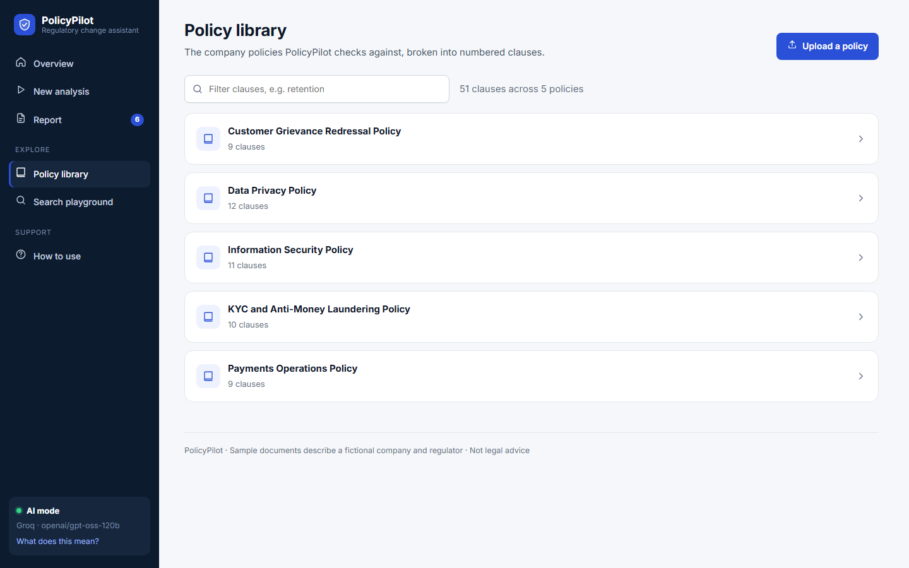
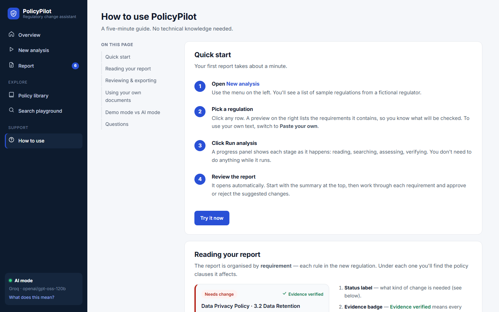
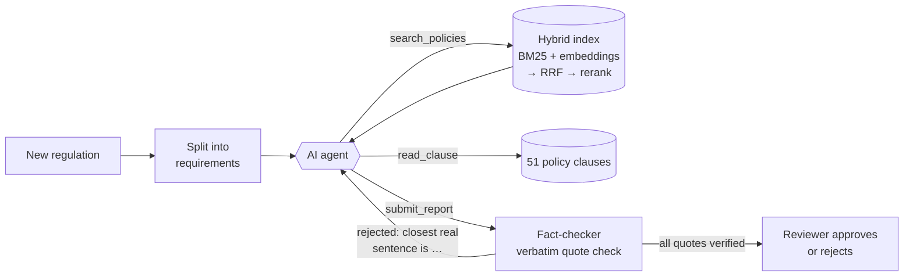

<div align="center">

# PolicyPilot

**An AI agent that reads a new regulation, finds every company policy it affects, drafts the
changes, and proves every claim with a quote that is checked automatically.**


-6E56CF)


[What it does](#what-it-does) · [Results](#results) · [How it works](#how-it-works) ·
[Run it](#run-it-in-3-minutes) · [System design](docs/SYSTEM_DESIGN.md) · [Plain-English tour](docs/HOW_IT_WORKS.md)



<sub>A real report produced by the AI agent (Groq · GPT-OSS 120B). Each card shows the new rule, today's policy wording,
the suggested rewrite (green = added, red = removed), and whether every quote was verified.</sub>

</div>

---

## At a glance

| | |
|---|---|
| **The problem** | When regulators publish new rules, compliance teams spend weeks finding which internal policies are now out of date, and rewriting them. AI can read fast but invents things, which is unacceptable in compliance. |
| **What I built** | A full-stack **agentic RAG** system. An LLM agent searches a policy library, decides what each new rule changes, and drafts new wording. A **deterministic fact-checker** then rejects any quote that isn't word for word in the source, and the agent has to fix it. A human approves every change. |
| **Result (measured)** | **96%** of correct clauses appear in the top-3 search results. On a labelled sample, the AI agent reached **100% precision** and **100% correct impact labels**, against 85% and 43% for a no-AI baseline. **100% of quotes shown to reviewers are verified.** [Details ↓](#results) |
| **Skills shown** | LLM tool use and agent loops · RAG (hybrid search, RRF fusion, cross-encoder reranking) · hallucination control · evaluation design · FastAPI · front-end UX · testing an LLM loop without an API · multi-provider LLM integration |

---

## What it does

Pick a regulation, click **Run analysis**, and get a report you can review and export:

| Step | What happens | Under the hood |
|---|---|---|
| **1. Read** | The regulation is split into numbered requirements (R1, R2…) | Document parsing |
| **2. Search** | Each requirement is matched against every policy clause, by **exact words** and by **meaning** | Hybrid retrieval: BM25 + embeddings → Reciprocal Rank Fusion → cross-encoder rerank |
| **3. Assess** | The AI agent decides what to search for, reads clauses, labels each one **Needs change**, **Missing from policy** or **Already compliant**, and drafts new wording | Tool-calling agent loop (search / read / submit) |
| **4. Verify** | Code checks every quote exists word for word. Failures go back to the agent with the closest real sentence | Deterministic verifier + self-correction loop |
| **5. Decide** | You compare old and new wording side by side, approve or reject, and export | Human in the loop |

<table>
  <tr>
    <td width="50%"><br><sub><b>Overview:</b> what it does, in plain English</sub></td>
    <td width="50%"><br><sub><b>New analysis:</b> a guided three-step flow</sub></td>
  </tr>
  <tr>
    <td width="50%"><br><sub><b>Policy library:</b> browse, filter and upload policies</sub></td>
    <td width="50%"><br><sub><b>How to use:</b> a built-in guide for non-technical users</sub></td>
  </tr>
</table>

---

## Results

I wrote the correct answers by hand for **25 requirements** across 6 sample regulations
([`data/eval/labels.jsonl`](data/eval/labels.jsonl)), then measured the system against them.
Full tables: [docs/EVAL_RESULTS.md](docs/EVAL_RESULTS.md).

**1. Search: does the right clause come up?** (all 25 requirements)

| Method | Right clause in top 3 | Ranked #1 | MRR |
|---|---|---|---|
| Exact words only (BM25, written from scratch) | 92% | 72% | 0.84 |
| Meaning only (bge-small embeddings) | 88% | 84% | 0.88 |
| **Hybrid + cross-encoder rerank** | **96%** | **80%** | **0.89** |

Each method misses things the other catches. "V-CIP" needs exact words; "storage limitation" ≈
"data retention" needs meaning. Combined, they put the right clause in the top 3 results 96% of the time.

**2. End to end: is the final report right?**

| Metric | No-AI baseline | AI agent (Groq · GPT-OSS 120B) |
|---|---|---|
| Precision: flagged clauses that are really affected | 85% | **100%** (9/9) |
| Recall: affected clauses found | 89% | 89% (8/9) |
| Impact label correct (needs change / missing / compliant) | 43% | **100%** (7/7) |
| Quotes valid in the final report | 100% | **100%** (1 corrected by the fact-checker) |

<sub>AI column: a measured sample of 2 of the 6 regulations (8 requirements), compared with the baseline on the same 8.
The full run was cut short by Groq free-tier rate limits. The baseline scores 85% / 89% / 50% across all 25 requirements.</sub>

**What this shows:** search finds the clauses; the agent adds the judgement. When the model got a
quote wrong, the fact-checker caught it and the model fixed it before anything reached the reviewer.

---

## How it works



**Engineering decisions worth discussing:**

| Decision | Why |
|---|---|
| Chunk at each policy's own numbering ("3.2 Data Retention"), not fixed token windows | A citation should point at a whole rule a human recognises |
| Hybrid retrieval instead of embeddings alone | Legal text mixes exact terms (V-CIP, T+1, AES-256) with paraphrases; the comparison table above shows the gain |
| Verify quotes with plain code, not a second LLM | A substring check can't hallucinate, costs nothing and is explainable |
| Send failures back *with the closest real sentence* | The model corrects itself instead of guessing again |
| Hand-written agent loop (~150 lines per provider) instead of a framework | Every step is visible and unit-testable |
| One agent interface, two providers (Anthropic and Groq/OpenAI-style) | The shared logic sits in `agent/base.py`; each provider file is just its message format |
| Tests run the real SDKs against a scripted fake API | The agent loop, retries and verify-and-fix flow are tested with no key or network |
| Offline demo mode | Anyone can clone and run it for free, and it doubles as the evaluation baseline |

More in [docs/SYSTEM_DESIGN.md](docs/SYSTEM_DESIGN.md): requirements, sequence diagrams, data model,
failure modes (including prompt injection), and a scaling plan.

---

## Run it in 3 minutes

Needs **Python 3.10+**. Works without any API key, in demo mode.

```bash
git clone https://github.com/vik-bit/policypilot.git
```
```bash
cd policypilot
```
```bash
python -m venv .venv
```
```bash
.venv\Scripts\activate
```
<sub>(macOS / Linux: `source .venv/bin/activate`)</sub>

```bash
pip install -r requirements.txt
```
```bash
python -m policypilot serve
```

Open **http://localhost:8000**. The **How to use** page in the app walks through everything.

**Turn on the AI agent:** copy `.env.example` to `.env` and choose a provider:

| Provider | Add to `.env` |
|---|---|
| **Groq** (free tier; open-weight models such as GPT-OSS 120B) | `PP_PROVIDER=groq` · `GROQ_API_KEY=gsk_...` |
| **Claude** (Anthropic) | `PP_PROVIDER=claude` · `ANTHROPIC_API_KEY=sk-ant-...` |

**Or with Docker:** `docker compose up`

| Command | What it does |
|---|---|
| `python -m policypilot analyze reg-01-data-protection` | Analyse a regulation from the terminal |
| `python -m policypilot search "how long do we keep data?"` | Try the search step on its own |
| `python -m policypilot eval` | Re-run the evaluation and regenerate `docs/EVAL_RESULTS.md` |
| `python -m pytest` | Run the 26 tests (no API key or internet needed) |

---

## The problem, in plain English

Banks and payment apps run on rulebooks called **policies**: "we keep customer data for 10 years",
"we report data breaches within 72 hours". Regulators keep publishing **new rules**, and every time
someone has to find what's now out of date and rewrite it.

> **An analogy.** Think of a smart intern with a strict editor. The intern (the AI) researches and
> writes the first draft. The editor (plain code, not AI) checks every quote against the original
> documents and sends the draft back if anything is made up. A manager (you) has the final say.

New to the terms? [docs/GLOSSARY.md](docs/GLOSSARY.md) explains RAG, embeddings, agents and more
in one or two sentences each. [docs/HOW_IT_WORKS.md](docs/HOW_IT_WORKS.md) follows one real run step by step.

---

## Project structure

```
policypilot/
├── policypilot/
│   ├── pipeline.py          ← start here: the whole flow in one function
│   ├── ingest/              ← split documents into clauses and requirements
│   ├── retrieval/           ← BM25 (from scratch), embeddings, RRF fusion, cross-encoder rerank
│   ├── agent/
│   │   ├── base.py          ← shared tool running + fact-check submission
│   │   ├── claude_agent.py  ← Anthropic Messages API loop
│   │   ├── groq_agent.py    ← Groq (OpenAI-style) loop, with retries for malformed model output
│   │   ├── verifier.py      ← deterministic quote checker
│   │   ├── prompts.py       ← system prompt + tool schemas
│   │   └── offline.py       ← no-AI baseline
│   ├── api/server.py        ← FastAPI: background jobs, search, uploads, decisions
│   ├── web/                 ← UI (HTML/CSS/JS, no build step)
│   └── eval/run_eval.py     ← retrieval and end-to-end scoring
├── data/                    ← sample policies, regulations, hand-written labels (fictional)
├── docs/                    ← system design, plain-English tour, glossary, results, screenshots
└── tests/                   ← 26 tests, including both agent loops against fake APIs
```

---

## Limitations and next steps

- **Small, fictional data set:** 51 clauses and labels written by one person. A production
  evaluation would need real documents and several reviewers.
- **The AI result is a sample** (8 requirements). `python -m policypilot eval` runs all 25.
- **The fact-checker proves a quote exists, not that the interpretation is right.** That's why a human
  approves every change.
- **Next:** analyse only what changed between versions of a regulation; prompt caching to cut cost;
  a vector database past ~10k clauses; an LLM judge for explanation quality.

---

<sub>Sample documents describe a fictional company ("Northwind Pay") and a fictional regulator. Not legal advice. MIT licensed.</sub>
