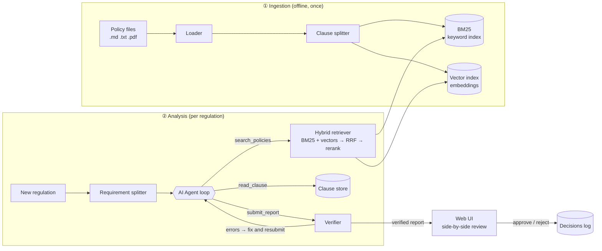
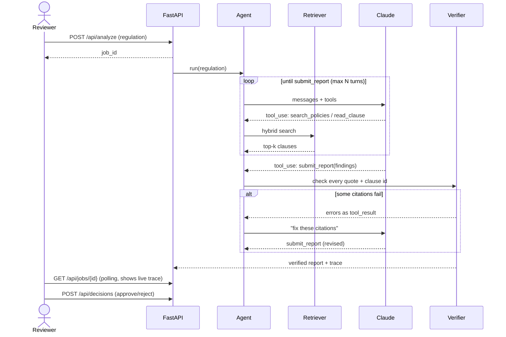
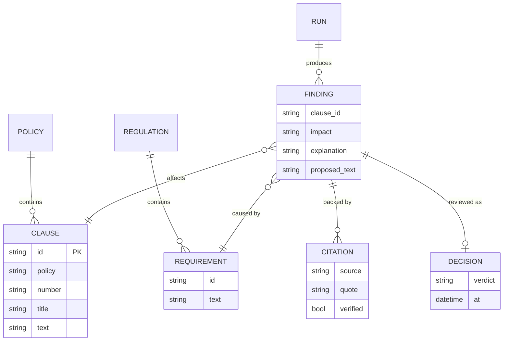

# PolicyPilot — System Design

> **One line:** When a new regulation arrives, PolicyPilot finds which parts of a company's
> internal policies it affects, drafts the changes, and proves every claim with a checked quote —
> then waits for a human to approve.

This document is written for two readers at once. Each section starts with a **plain-English**
summary, followed by the **engineering detail**.

---

## 1. The problem

**Plain English.** Companies (banks, payment apps, insurers) have dozens of internal rulebooks
called *policies*. Regulators keep publishing new rules. Today, a compliance officer reads every new
rule, hunts through every policy to see what is now out of date, and rewrites it by hand. It is slow,
and a missed change can mean fines.

AI can read fast, but AI also *makes things up* ("hallucinates"). In compliance, a made-up citation is
worse than no answer. So the hard part is not "use an LLM" — it is **"use an LLM and prove every
sentence it writes."**

**Engineering framing.**

| | |
|---|---|
| Input | (a) a corpus of policy documents, (b) one regulation update |
| Output | a list of *findings*: affected clause, impact type, explanation, proposed new text, and citations (quotes) from both the regulation and the policy |
| Hard constraint | every citation must be verifiable against the source text |
| Human role | a reviewer approves or rejects each proposed edit |

### Goals
1. **Find** the policy clauses a regulation affects (high recall — missing one is the costly error).
2. **Explain** the impact in plain language: *conflict* (policy says something the rule now forbids),
   *gap* (policy is silent on something the rule now requires), or *aligned* (already compliant).
3. **Draft** replacement clause text.
4. **Prove** each claim with a quote that is mechanically checked to exist in the source.
5. **Measure** quality with a labelled evaluation set, not vibes.

### Non-goals (for the 1-week scope)
- Legal advice. The system drafts; humans decide.
- Multi-tenant SaaS, auth, billing.
- Real-time scraping of regulator websites (documents are uploaded or dropped in a folder).

---

## 2. Requirements

### Functional
| ID | Requirement |
|---|---|
| F1 | Ingest policies from `.md`, `.txt`, `.pdf`; split into numbered clauses |
| F2 | Search clauses by meaning *and* by exact wording |
| F3 | Analyse a regulation with an AI agent that searches, reads, and reports findings |
| F4 | Verify every citation; send failures back to the agent to fix |
| F5 | Web UI: pick/paste a regulation, watch the agent's steps live, review side-by-side, approve/reject |
| F6 | Evaluation harness producing retrieval and citation metrics |
| F7 | Run fully **offline** (no API key) with a deterministic fallback analyser, so anyone can try it |

### Non-functional
| Concern | Target |
|---|---|
| Faithfulness | 100% of *shown* citations pass the verbatim check (unverifiable ones are dropped or flagged, never shown as verified) |
| Latency | first-pass retrieval < 100 ms for ~1k clauses; cross-encoder rerank ~0.5–1 s on CPU (small next to an LLM turn); full analysis < 2 min |
| Cost | < $0.50 per regulation analysed with the default model |
| Explainability | every agent step is logged and visible in the UI ("trace") |
| Portability | `pip install` + one command, or `docker compose up` |

---

## 3. High-level architecture

**Plain English.** Think of it as a small team:
- a **librarian** who cuts every policy into numbered clauses and indexes them (ingestion + index),
- a **researcher** who can look clauses up two ways — by meaning and by exact words (hybrid retrieval),
- an **analyst** (the AI agent) who reads the new rule, asks the researcher for clauses, and writes findings,
- a **fact-checker** who checks every quote the analyst used and sends the work back if a quote is fake,
- a **manager** (you) who approves or rejects each change.



### Request flow (one analysis)



---

## 4. Components in detail

### 4.1 Ingestion — `policypilot/ingest/`

**Plain English.** A policy is a long document; the AI needs bite-sized, *addressable* pieces. We cut
along the document's own numbering ("4.2 Data Retention") so every piece has a stable ID a human
recognises.

**Detail.**
- **Loader**: `.md`/`.txt` read directly; `.pdf` via `pypdf` text extraction.
- **Clause splitter**: regex on numbered headings (`## 4.2 Title`, `4.2 Title`, `Section 4.2`).
  Falls back to paragraph chunks of ~120 words with 1-paragraph overlap when no numbering exists.
- **Clause ID**: `<policy_slug>§<number>`, e.g. `data-privacy§4.2`. Stable across re-ingestion, readable
  in the UI, and used as the citation key.
- **Why clause-level chunking instead of fixed 512-token windows?** Compliance work is *about* clauses.
  A fixed window can cut a clause in half, so a citation would point at half a rule. Clause chunks keep
  semantic units intact and make citations human-checkable.

### 4.2 Retrieval — `policypilot/retrieval/`

**Plain English.** Searching by *meaning* finds "keep records for five years" when you ask about
"data retention". Searching by *exact words* finds "Video-KYC" or "Section 12(3)" — terms meaning-search
blurs. We do both and merge the results.

**Detail.**

| Stage | What | Why |
|---|---|---|
| BM25 | Classic keyword ranking (implemented from scratch, ~60 lines) | Exact terms, acronyms, section numbers |
| Dense | Embeddings + cosine similarity. Uses `fastembed` (`BAAI/bge-small-en-v1.5`, ONNX, CPU) when installed; otherwise a built-in hashed character n-gram TF-IDF vectoriser so it always works offline | Paraphrases, synonyms |
| Fusion | **Reciprocal Rank Fusion**: `score = Σ 1/(60 + rank)` across both lists | Merges rankings without needing comparable scores |
| Rerank (optional) | Cross-encoder (`fastembed` `Xenova/ms-marco-MiniLM-L-6-v2`) re-scores the top 20 | Reads query and clause *together*; more accurate than either index alone |

Index persisted to `data/index/` (`clauses.json`, `bm25.json`, `vectors.npy`). Rebuilt with
`python -m policypilot ingest`.

**Why not a vector database?** At ~1k clauses, a NumPy matrix multiply takes < 1 ms. A vector DB
(Qdrant/pgvector) adds a service to run with no benefit at this size. The `DenseIndex` interface
is small, so swapping in Qdrant later is a one-file change (see §9).

### 4.3 The agent — `policypilot/agent/`

**Plain English.** Instead of one giant prompt ("here is everything, answer"), the AI works like a
person: it decides what to search for, reads the results, searches again if needed, and only then
writes its report. This is what "agentic" means.

**Detail.** A *manual tool-use loop* over the Claude Messages API (no framework), so every step is
visible and testable.

| Tool | Input | Returns |
|---|---|---|
| `search_policies` | `query`, `k` | ranked clause IDs, titles, snippets, scores |
| `read_clause` | `clause_id` | full clause text |
| `submit_report` | `findings[]`, `summary` | verifier result (accepted, or list of errors to fix) |

Each finding:
```json
{
  "clause_id": "data-privacy§4.2",
  "impact": "conflict | gap | aligned",
  "requirement_id": "R2",
  "explanation": "Policy keeps logs 2 years; the regulation now requires 5.",
  "regulation_quote": "retain transaction logs for a minimum of five years",
  "policy_quote": "Transaction logs are retained for two (2) years",
  "proposed_text": "Transaction logs shall be retained for a minimum of five (5) years ..."
}
```

**Loop control.**
- Max 16 model turns; max 2 verification retries. On exhaustion, return what verified and flag the rest.
- Tools are declared with `strict: true` so arguments always match the schema.
- `tool_choice` stays `auto` (the default model rejects forced tool choice); the system prompt says the
  run ends only through `submit_report`, and the loop nudges once if the model replies with plain text.
- The full `response.content` (including thinking blocks) is appended back each turn, as the API requires.

**Why a hand-written loop instead of LangGraph?** For three tools and one loop, a framework adds
concepts without adding capability. ~150 readable lines show exactly what an agent *is*. (A LangGraph
port is listed as a stretch goal.)

**Models.** Default `claude-opus-5-5` at effort `medium`; configurable via `PP_MODEL`, `PP_EFFORT`.
Server-side refusal fallback (`fallbacks: "default"`) is enabled so a safety decline is rerouted rather than failing the run.

### 4.4 The verifier — `policypilot/agent/verifier.py`

**Plain English.** The fact-checker. For every quote the AI used, it opens the original document and
checks the quote is really there, word for word. If not, it tells the AI exactly what was wrong and
asks for a fix. Nothing unverified is shown as verified.

**Detail.** Deterministic checks, in order:
1. `clause_id` exists in the store.
2. `policy_quote` is a substring of that clause (after normalising whitespace, quotes, and case).
3. `regulation_quote` is a substring of the regulation text.
4. `impact` ∈ {conflict, gap, aligned}; `gap` findings may have an empty `policy_quote`
   (the point is that the policy is silent), but must still name the closest clause.
5. Near-miss help: if a quote fails, the verifier finds the closest sentence (difflib ratio) and includes
   it in the error, so the agent can correct rather than guess again.

Errors go back as the `tool_result` of `submit_report` with `is_error: true`. This keeps the conversation
append-only and lets the model self-correct in context.

**Why deterministic rather than "LLM-as-judge"?** A substring check cannot hallucinate and costs nothing.
LLM judging is reserved for the *evaluation* of explanation quality, not for gating.

### 4.5 Offline analyser — `policypilot/agent/offline.py`

**Plain English.** So anyone can run the demo without paying for an API key, there's a simple
non-AI version: for each requirement it runs the same search and builds findings from the top results.
It's dumber, but it exercises the same retrieval, verifier, UI and evaluation.

**Detail.** For each requirement: hybrid search → top clause above a score threshold → finding with
`impact` guessed by keyword cues ("must", "within", numbers that differ), quotes taken as the best-matching
sentence on each side (so they always verify). Clearly labelled "offline mode" in the UI and reports.

### 4.6 API — `policypilot/api/server.py` (FastAPI)

| Method | Path | Purpose |
|---|---|---|
| GET | `/api/health` | mode (`claude` / `offline`), model, index size |
| GET | `/api/regulations` | bundled sample regulations |
| GET | `/api/policies` | list policies and clause counts |
| POST | `/api/policies` | upload a policy file → re-index |
| GET | `/api/search?q=` | raw hybrid search (for exploring) |
| POST | `/api/analyze` | start an analysis job → `job_id` |
| GET | `/api/jobs/{id}` | status, live trace events, final report |
| POST | `/api/decisions` | approve / reject a finding |

Jobs run in a background thread; state in memory, reports also written to `data/runs/<id>.json`.
Polling (every 1 s) was chosen over WebSockets/SSE for simplicity and robustness.

### 4.7 UI — `policypilot/web/`

A single static page (HTML + vanilla JS + CSS), served by FastAPI. No build step.
- Left: pick a sample regulation or paste one.
- Middle: live **agent trace** ("🔍 searched 'log retention' → 5 clauses", "📖 read data-privacy§4.2",
  "✅ verifier: 6/6 citations OK").
- Right: **finding cards** — current clause vs proposed text side-by-side, highlighted quotes, a
  "verified" badge per citation, Approve / Reject buttons.
- A "How does this work?" panel explains each stage in plain English.

---

## 5. Data model



---

## 6. Evaluation

**Plain English.** We wrote down the right answers ourselves for a set of test cases, then score the
system against them. This turns "it seems to work" into numbers you can put in a README.

**Labelled set** — `data/eval/labels.jsonl`: one line per regulation requirement with the clause IDs a
careful human says it affects (written by hand from the sample documents).

| Metric | Measures | Needs API key? |
|---|---|---|
| Recall@k | Did the right clause appear in the top *k* search results? | No |
| MRR | How high did the first right clause rank? | No |
| Finding precision / recall | Did the final report flag the right clauses and only those? | Offline or Claude |
| Citation validity | % of citations that pass the verbatim check | Offline or Claude |
| Verifier lift | Citation validity **before** vs **after** the fix-up loop | Claude |

Retrieval is evaluated as an **ablation**: BM25 only, dense only, hybrid (RRF), hybrid + rerank — so the
README can show *why* each stage exists.

Run: `python -m policypilot eval` → prints tables and writes `docs/EVAL_RESULTS.md`.

---

## 7. Failure modes and mitigations

| Risk | Mitigation |
|---|---|
| Hallucinated citation | Verbatim verifier + fix-up loop; unverified never shown as verified |
| Missed affected clause | Hybrid retrieval tuned for recall; agent prompted to search per requirement; recall measured |
| Prompt injection inside a regulation ("ignore previous instructions…") | Regulation text wrapped in `<regulation>` tags and declared *data* in the system prompt; agent tools are read-only; output gated by a human |
| Agent loops forever | Hard turn cap and retry cap |
| PDF extraction garbage | Clause splitter falls back to paragraphs; ingestion report lists clause counts per file |
| API outage / no key | Offline analyser; typed error handling with retries (SDK default 2) |
| Model safety decline | Server-side fallback; `stop_reason == "refusal"` handled and surfaced |

---

## 8. Key decisions (trade-off log)

| Decision | Chosen | Alternative | Why |
|---|---|---|---|
| Chunking | Clause-aware | Fixed token windows | Citations must point at whole, human-meaningful rules |
| Retrieval | Hybrid BM25 + dense + RRF | Dense only | Legal text is full of exact terms dense search blurs |
| Vector store | NumPy in-process | Qdrant / pgvector | Scale doesn't need it; fewer moving parts |
| Agent framework | Hand-written loop | LangGraph / LangChain | Transparency; fewer abstractions for 3 tools |
| Gating | Deterministic substring verifier | LLM-as-judge | Cannot hallucinate, free, explainable |
| Live updates | Polling | WebSockets / SSE | Simplest thing that works |
| UI | Static HTML/JS | Next.js | No build step; anyone can read it |
| No-key mode | Offline rule-based analyser | Require a key | Anyone can clone and run the demo |

---

## 9. How it would scale (beyond the 1-week scope)

- **10k+ clauses**: swap `DenseIndex` for Qdrant/pgvector; keep BM25 in OpenSearch.
- **Many regulations per day**: queue (Redis/RQ) + workers; Message Batches API for non-urgent runs (50% cheaper).
- **Cost**: prompt caching on the static system prompt + tool definitions.
- **Teams**: auth, per-tenant indexes, audit log of every decision.
- **Change tracking**: diff a regulation against its previous version and analyse only changed paragraphs.

---

## 10. Repository map

```
policypilot/
├── README.md                 ← start here (plain English)
├── docs/
│   ├── SYSTEM_DESIGN.md      ← this file
│   ├── HOW_IT_WORKS.md       ← guided tour of one run, step by step
│   ├── GLOSSARY.md           ← every AI term explained simply
│   └── EVAL_RESULTS.md       ← generated by the eval command
├── data/
│   ├── policies/             ← sample company policies (fictional)
│   ├── regulations/          ← sample regulation updates (fictional)
│   └── eval/labels.jsonl     ← hand-labelled answers
├── policypilot/
│   ├── ingest/               ← load + split into clauses
│   ├── retrieval/            ← BM25, embeddings, fusion, rerank
│   ├── agent/                ← prompts, tools, loop, verifier, offline mode
│   ├── api/                  ← FastAPI server
│   ├── web/                  ← the UI
│   ├── eval/                 ← evaluation harness
│   └── cli.py                ← `python -m policypilot ...`
└── tests/
```
